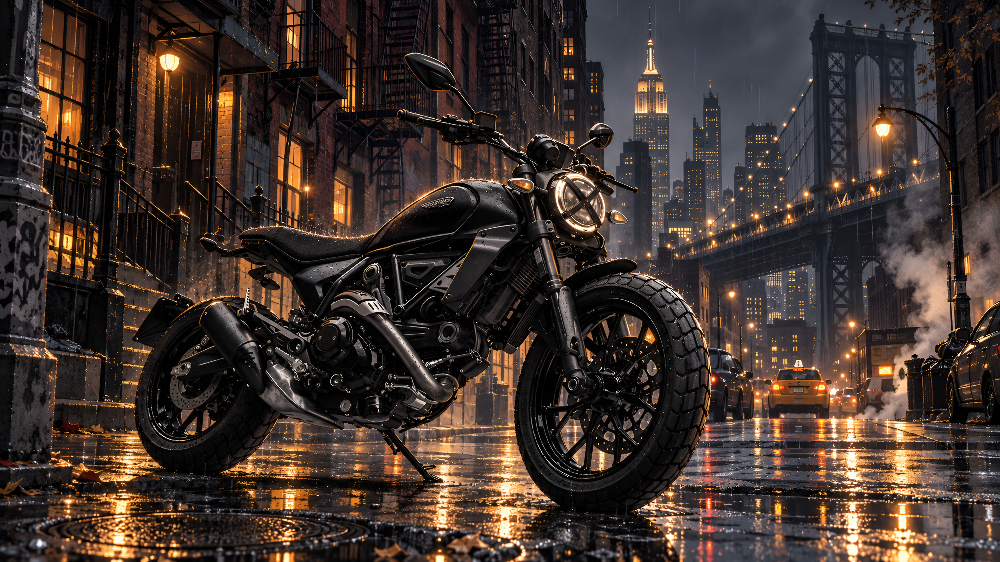

# ducati-scrambler-icon-dark-nyc

A dark Omarchy theme built around a Ducati Scrambler Icon — murdered-out black, parked on a rain-soaked New York City street at night. Steam rising from the manholes, a yellow cab waiting at the light, the Empire State Building glowing above the rooftops — big-city noir vibes. The palette follows the artwork: deep blacks warmed by amber streetlight tones, with a soft periwinkle accent. My heart beats for motorcycles — and now my desktop does too.

## Backgrounds



## Install

```bash
omarchy theme install https://github.com/pdaether/omarchy-ducati-scrambler-icon-dark-nyc-theme.git
```
